
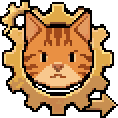
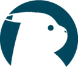
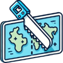
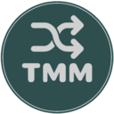
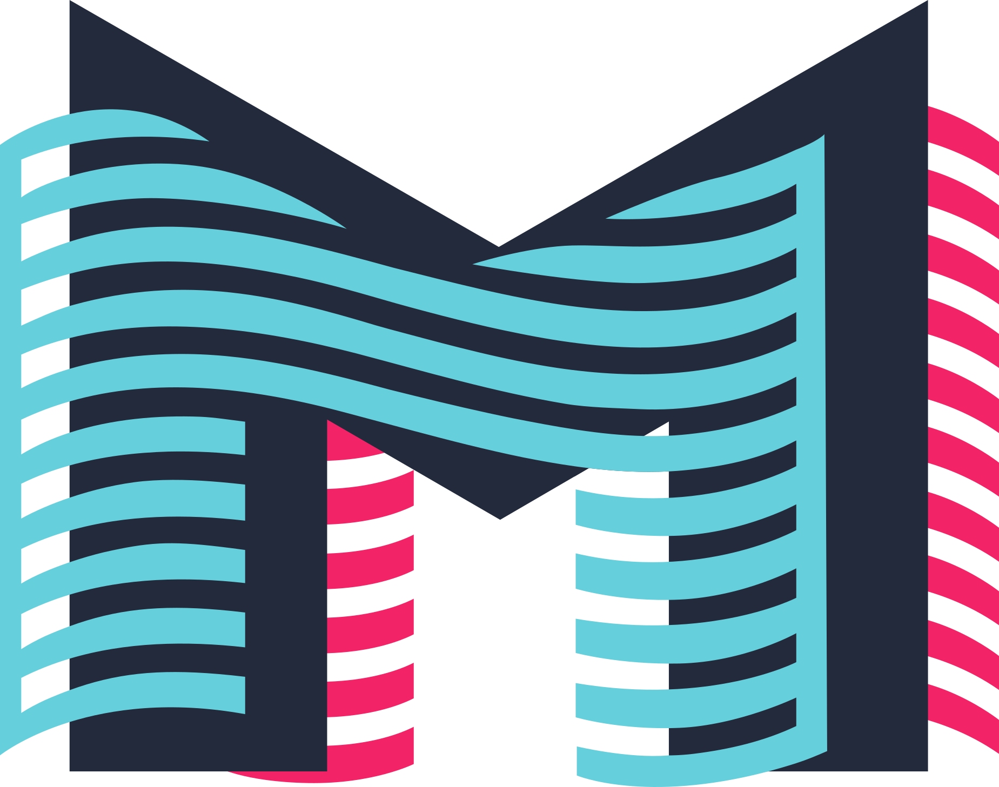

## Hi, I'm Murad and I build stuff

### In progress

<table><tr><td>

<b>Meowtomation</b> · 2026 
A factory game where every machine is worked by a cat. 
 Rust &nbsp;  Bevy
</td></tr></table>

<table><tr><td>

<a href="https://pokedb.org"><b>PokeDB</b></a> · 2024-2026 
A Pokémon database: Pokédexes, moves, abilities, items and interactive region maps. 
 Next.js &nbsp;  PostgreSQL &nbsp;  Drizzle &nbsp;  AWS &nbsp;  Leaflet
</td></tr></table>

### Done

<table><tr><td>

<b>Shoebox</b> · 2026 · personal desktop tool 
Files scanned paperwork into one searchable, deduplicated library with OCR and clean names. 
 Java &nbsp;  React &nbsp;  SQLite &nbsp;  Claude API
</td></tr></table>

<table><tr><td>

<a href="https://github.com/EKO-GITHUB/folio"><b>Folio</b></a> · 2026 · personal desktop tool 
Turns a folder of audiobook files into one tagged M4B with chapters and cover art. 
 Rust &nbsp;  FFmpeg
</td></tr></table>

<table><tr><td>

<a href="https://leafletmapdivider.com"><b>Leaflet Map Divider</b></a> · <a href="https://github.com/EKO-GITHUB/leaflet-map-divider">repo</a> · 2025-2026 
Slices a large image into LeafletJS map tiles for every zoom level, right in your browser. 
 Next.js &nbsp;  Leaflet
</td></tr></table>

<table><tr><td>

<a href="https://muradtochiev.de/"><b>Personal website</b></a> · 2025-2026 
My portfolio, plus Murad's Park: a 3D Unity world where you walk around to discover my projects. 
 Next.js &nbsp;  Unity
</td></tr></table>

<table><tr><td>

<a href="https://tvlowlights.com"><b>TV Lowlights</b></a> · 2026 
Search any TV show to find its worst-rated episodes and why they fell flat. 
 Next.js &nbsp;  Claude API &nbsp;  TMDB &nbsp;  DynamoDB
</td></tr></table>

<table><tr><td>

<a href="https://www.tilemapmaker.org/"><b>TileMapMaker</b></a> · 2024-2026 
Generates tile-based maps with the Wave Function Collapse algorithm. 
 Next.js
</td></tr></table>

<table><tr><td>

<a href="https://ttwrapped.com"><b>TTWrapped</b></a> · <a href="https://github.com/EKO-GITHUB/ttwrapped">repo</a> · 2025-2026 
A Spotify Wrapped-style year in review of your TikTok data, processed in your browser. 
 Next.js &nbsp;  tRPC
</td></tr></table>

<table><tr><td>

<a href="https://convert2ascii.com"><b>Convert 2 ASCII</b></a> · <a href="https://github.com/EKO-GITHUB/convert-to-ascii">repo</a> · 2025 
Turns images into ASCII art, in color or mono, entirely in your browser. 
 Next.js
</td></tr></table>

### Abandoned

<table><tr><td>

<b>Monsoon</b> · 2026 
A self-hosted media server: one Docker image that builds its own AWS streaming stack. 
 Rust &nbsp;  React &nbsp;  Electron &nbsp;  AWS &nbsp;  Docker &nbsp;  FFmpeg 
<b>Why abandoned:</b> fresh AWS accounts can't run it. GPU instances, rate limits and CDN quotas all need manual approval from AWS support, which can still be denied.
</td></tr></table>

### Earlier work

Game of Life Simulation (Django), [ImageID](https://github.com/EKO-GITHUB/ImageID) (Angular, Electron), Area Defender (Java) and viewR (Spring Boot), all from 2023.
