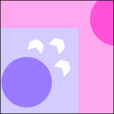

## Hi, I'm Murad and I build stuff

### Live projects

<table><tr><td>

<a href="https://pokedb.dev"><b>PokeDB</b></a> &nbsp;2024 – 2026 
A Pokémon field guide: locations, learnsets and item find-spots for every mainline game. 
 Next.js &nbsp;  PostgreSQL &nbsp;  Drizzle &nbsp;  AWS &nbsp;  Leaflet
</td></tr></table>

<table><tr><td>

<a href="https://leafletmapdivider.com"><b>Leaflet Map Divider</b></a> · <a href="https://github.com/EKO-GITHUB/leaflet-map-divider">repo</a> &nbsp;2025 – 2026 
Slices a large image into LeafletJS map tiles for every zoom level, right in your browser. 
 Next.js &nbsp;  Leaflet
</td></tr></table>

<table><tr><td>

<a href="https://tvlowlights.com"><b>TV Lowlights</b></a> &nbsp;2026 
Search any TV show to find its worst-rated episodes and why they fell flat. 
 Next.js &nbsp;  Claude API &nbsp;  TMDB &nbsp;  DynamoDB
</td></tr></table>

<table><tr><td>

<a href="https://ttwrapped.com"><b>TTWrapped</b></a> · <a href="https://github.com/EKO-GITHUB/ttwrapped">repo</a> &nbsp;2025 – 2026 
A Spotify Wrapped–style year in review of your TikTok data, processed in your browser. 
 Next.js &nbsp;  tRPC
</td></tr></table>

<table><tr><td>

<a href="https://convert2ascii.com"><b>Convert 2 ASCII</b></a> · <a href="https://github.com/EKO-GITHUB/convert-to-ascii">repo</a> &nbsp;2025 
Turns images into ASCII art, in color or mono, entirely in your browser. 
 Next.js
</td></tr></table>

### Currently building

<table><tr><td>

<b>Shoebox</b> &nbsp;2026 
Files scanned paperwork into one searchable, deduplicated library with OCR and clean names. 
 Java &nbsp;  React &nbsp;  SQLite &nbsp;  Claude API
</td></tr></table>

<table><tr><td>

<b>Meowtomation</b> &nbsp;2026 
A factory game where every machine is worked by a cat. 
 Rust &nbsp;  Bevy
</td></tr></table>

<table><tr><td>

<b>Folio</b> &nbsp;2026 
Turns a folder of audiobook files into one tagged M4B with chapters and cover art. 
 Rust &nbsp;  FFmpeg
</td></tr></table>

<table><tr><td>

<b>Monsoon</b> &nbsp;2026 
A self-hosted media server that turns a folder of videos into a streaming service on AWS. 
 Rust &nbsp;  React &nbsp;  Electron &nbsp;  AWS &nbsp;  Docker &nbsp;  FFmpeg
</td></tr></table>

<table><tr><td>

<b>TileMapMaker</b> &nbsp;2024 – 2026 
Generates tile-based maps with the Wave Function Collapse algorithm. 
 Next.js
</td></tr></table>

### Earlier work

<table><tr><td>

<b>Game of Life Simulation</b> &nbsp;2023 
Conway's Game of Life in the browser. 
 Django
</td></tr></table>

<table><tr><td>

<a href="https://github.com/EKO-GITHUB/ImageID"><b>ImageID</b></a> &nbsp;2023 
A desktop app that identifies landmarks, logos and objects in images. 
 Angular &nbsp;  Electron &nbsp;  Google Cloud Vision
</td></tr></table>

<table><tr><td>

<b>Area Defender</b> &nbsp;2023 
A 2D defense game. 
 Java
</td></tr></table>

<table><tr><td>

<b>viewR</b> &nbsp;2023 
A media management and tagging app. 
 Spring Boot
</td></tr></table>
